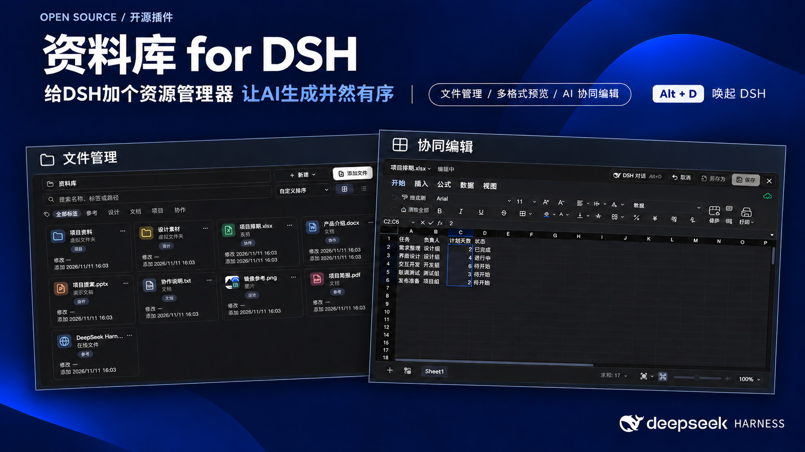
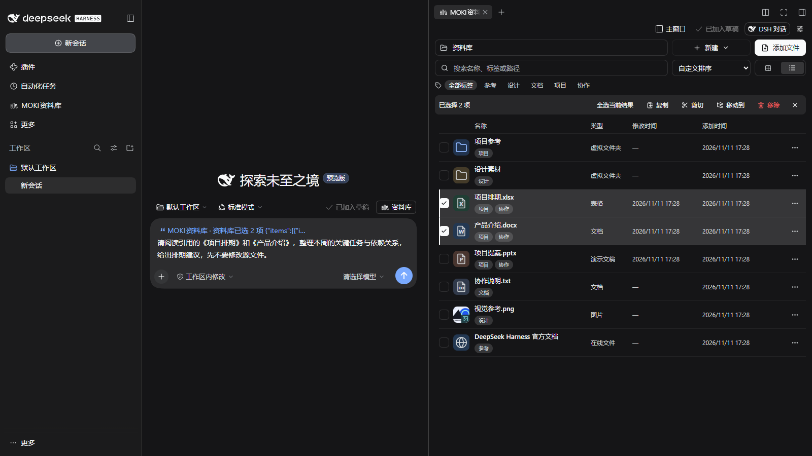
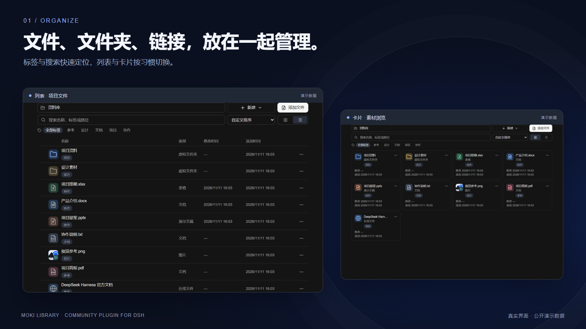
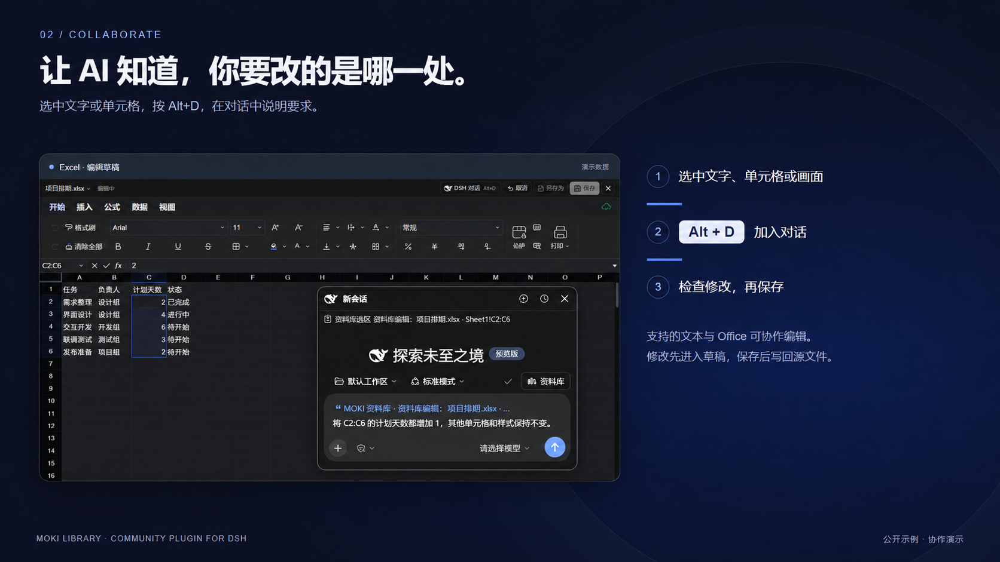
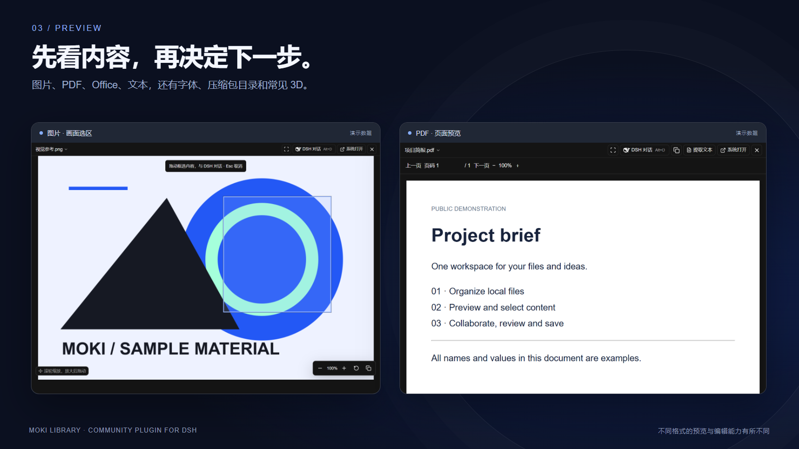

# MOKI Library for DSH

English · [简体中文](README.zh-CN.md)



**Give DSH a file explorer. Keep AI-generated work organized.**

MOKI Library is a community plugin for **DeepSeek Harness (DSH)**. It brings a local file library, multi-format previews and Office editing into the same workspace as your DSH conversations.

Move from finding a file to reading, selecting, editing and saving it in one workflow. Organize a project, then keep its documents and spreadsheets beside the conversation.

[Five usage demos](docs/usage-demos.md) · [Preview and editing format support](docs/formats.md) · [Media kit](docs/social/README.md)

[Download](https://github.com/JKZeng-cell/moki-library-for-dsh/releases/latest) · [Usage guide (中文)](docs/guide.zh-CN.md) · [Features](docs/features.md) · [Report an issue](https://github.com/JKZeng-cell/moki-library-for-dsh/issues)

## What you can do

- **Manage files, folders and links.** Map existing local files, organize virtual folders and tags, search, and switch between list and card views. An empty folder welcomes drag-and-drop imports.
- **Preview without switching apps.** Images, audio/video, PDF, Office, text, archives, fonts and common 3D formats have built-in preview paths. Some formats require conversion or have documented limitations.
- **Edit Word, Excel and PowerPoint.** Work on isolated drafts, see changes in the editor, then save back or save a copy.
- **Collaborate on a precise selection.** Pass text offsets, sheet/range addresses, slide objects, page numbers or a selected image region to DSH. Use **Alt+D** to open the conversation while viewing a document.
- **Choose your workspace.** Use the main library, side-workspace tabs, movable native preview windows, or your system's default app. The floating conversation supports the native DSH input capabilities.
- **Connect files to conversations.** Optionally add a library attachment picker above the composer and automatically map newly created DSH task files.
- **Keep context compact.** Selection references carry bounded content and exact locations. Supported edits use `context → edit_selection`; complex edits can use the Office tools.



**Library and conversation in one window.** In this actual local DSH Web capture, “项目排期.xlsx” and “产品介绍.docx” are selected in the side workspace. **Add selection to conversation** places a native reference in the composer, followed by the user's request. The files are demonstration data and the input is an unsent draft. [Card-view alternative](docs/media/dsh-workspace-cards.png).





## Install

Tested on **Windows with DSH Desktop 0.2.2-rc.1**. Declared compatibility: `>=0.2.2-rc.1 <0.3.0`; other desktop versions and operating systems need further verification. The plugin requires **Node.js 22.19+**. Native preview windows use a locally installed Edge or Chrome. FFmpeg is optional for additional audio/video decoding.

1. Open DSH Desktop once to initialize its desktop profile, then fully quit it. Download `dsh-moki-library-0.1.58.tgz` from the [release](https://github.com/JKZeng-cell/moki-library-for-dsh/releases/tag/v0.1.58).
2. Use the DSH CLI from the desktop installation, replacing the path below with your downloaded archive's absolute path:

```powershell
dsh plugin --profile desktop add 'dsh-moki-library@file:C:/Downloads/dsh-moki-library-0.1.58.tgz' --allow-build=sharp
```

On Windows, the bundled command is `<DSH install directory>/resources/runtime/cli/bin/dsh.cmd`. First installation downloads the runtime dependencies. Restart DSH if the plugin manager requests it.

The GitHub source archive is for development; the `.tgz` release asset is the built plugin. This release does not require an npm publication.

## Selection collaboration

### Your first workflow

1. Open **MOKI Library** from DSH's sidebar. Use **Add files** or drag files, folders and links into the content area.
2. Organize virtual folders and tags. Search by name, tag or path, clear the search with one click, and switch between list/card views. Hover over a thumbnail for a larger preview.
3. Open a file. By default, the main library uses separate preview windows and the side workspace opens new tabs. Settings can explicitly choose DSH's main window, a separate window or the default app.
4. For editable formats, enter **Edit**, select the relevant content, press **Alt+D** and choose **Add selection to conversation**. Describe the task.
5. Review the result, then **Save** or **Save as**. AI edits stay in the draft until saved. Reopen the file to check persistence.

### Practical examples

| Task | Select first | Example prompt and check |
| --- | --- | --- |
| Excel schedule | `C2:C6` on the intended sheet | “Increase each selected planned-day value by 1; preserve other cells and styles.” Inspect, save and reopen |
| Word / text revision | A passage | “Make this more concise, preserving facts and proper names. Change only the selected range.” Check context and styles |
| PowerPoint heading | Highlighted text inside the intended text box | “Replace with ‘Review before saving’; preserve the box position and font size.” Check wrapping and layout |
| PDF reading | Text on the relevant page | “Explain this passage, identify its page and list conditions I should verify.” Read-only analysis |
| Image / scanned page | A selected region | “Describe this region and explicitly mark unreadable text.” Requires a vision-capable model |



The [illustrated usage demos](docs/usage-demos.md) include exact steps, sample prompts, expected checks and window/workspace choices. Sample prompts are instructions, not fabricated AI transcripts.

### Selections, attachments and task files

**Add selection to conversation** carries selected content and its location. **Library → Add attachments** supplies selected files, after enabling the library composer button in settings. Separately, **automatic task-file mapping** collects newly created/delivered DSH files in “DSH task files” after it is enabled, deduplicating identical paths.

The floating conversation uses DSH's native input, supports moving/resizing and creating/switching conversations. In a separate preview, Alt+D opens it inside that preview window.

Default context text is bounded to 4,000 characters; composer quotes to 1,000. Truncation is marked. Tools can request more content when needed. Selection references are scoped to the conversation/editor, expire after ten minutes, and reject stale or reused edits.

## Preview and editing formats

| Category | Main formats | Preview | In-plugin editing |
| --- | --- | --- | --- |
| Word / Excel / PowerPoint | DOCX, XLSX, PPTX | Supported | Supported; review the draft before saving |
| Delimited data / workspace | CSV, TSV, UNIVER | Supported | Supported; CSV/TSV do not retain workbook styling |
| Text and code | TXT, MD, JSON, HTML, XML, YAML, JS/TS, Python and more | Supported | Listed editable extensions up to 5 MB |
| Legacy / Apple Office | DOC, PPT, PAGES, NUMBERS, KEY | Limited content extraction | No; convert to an editable format first |
| Images / design files | PNG, JPEG, GIF, WebP, SVG, BMP, AVIF, ICO, PSD/PSB, TGA, TIFF | Image or composite preview | No image/layer editor |
| PDF / OFD / AI | PDF, OFD, PDF-compatible AI | Page, text or region | Reading/analysis, not source-format editing |
| Audio / video | MP4, MOV, MKV, AVI, WebM; MP3, WAV, FLAC, AAC, OGG and more | Codec-dependent, optional FFmpeg | No media editing workflow |
| 3D / fonts | GLB, glTF, OBJ, STL, PLY, FBX; TTF, OTF, WOFF, WOFF2 | Model controls / font samples | No model/font source editing |
| Archives | ZIP/ZIP64, RAR5, 7z, TAR, GZ, BZ2, XZ, CAB and more | Read-only directory/search/paging | No archive-content editing |

HEIC/HEIF depend on decoder availability. Legacy XLS, macro-enabled and password-protected documents are not listed as supported embedded editing formats. See the [full matrix](docs/formats.md) for extensions, sidecar resources, read-only formats and size limits. **Preview support does not imply editing support or complete fidelity for every file variant.**

## Data and limits

The catalog, generated files and editing drafts are stored locally under `DSH_HOME/moki-library` or the user's `.dsh/moki-library` directory. Mapping an existing file keeps its original path. **Content selected for AI collaboration or attached to a conversation is provided to DSH and its configured model/tools.** Local storage is not a promise of offline AI processing.

There is no single size cap for mapped files or streamed original-file previews. Decoder support, available memory and disk space still apply. Conversation attachments have a separate **32 MB** limit. Text over **5 MB** uses read-only paging. Whole-file decoding for selected preview types uses a **512 MiB** guard; Office structured-data previews use a **256 MiB** expanded-data budget. See the [format and size details](docs/guide.zh-CN.md#文件预览与大小).

## Build and test

```sh
npm ci
npm run build
npm test
node scripts/collect-licenses.mjs
npm pack
```

The browser/Office tests use an installed Chrome or Edge. Tests create synthetic temporary files, never the user's library. Tests run serially to avoid competing Office runtimes. `src/` contains the DSH integration, `web/` the embedded UI, and `vendor/moki/` the required MOKI library modules.

## Open source and community

- **MIT** for MOKI's source and the included MOKI modules. Dependencies retain their own licenses; see [third-party notices](THIRD_PARTY_NOTICES.md).
- [Contributing](CONTRIBUTING.md) · [Public-release hygiene](docs/public-release.md) · [Media kit](docs/social/README.md).
- Discover DSH extensions through the official [`dsh-plugin` topic](https://github.com/topics/dsh-plugin) and [DeepSeek Harness Discussions](https://github.com/deepseek-ai/deepseek-harness/discussions).
- Join the [MOKI Library community discussion](https://github.com/deepseek-ai/deepseek-harness/discussions/12941) in **Show Your Plugins!**.

Developed by **JKZeng / MOKI**. Contact: [GitHub Issues](https://github.com/JKZeng-cell/moki-library-for-dsh/issues). This is an independent community plugin, not an official DeepSeek product. The DeepSeek Harness logo identifies the host application and belongs to its respective owner.
