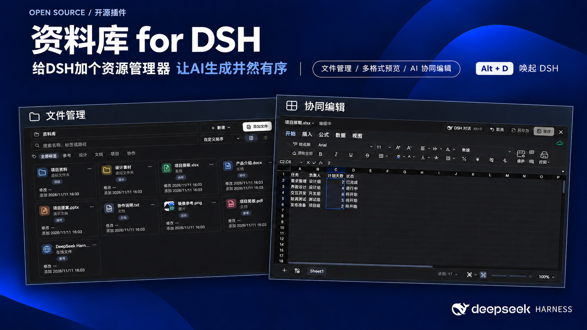
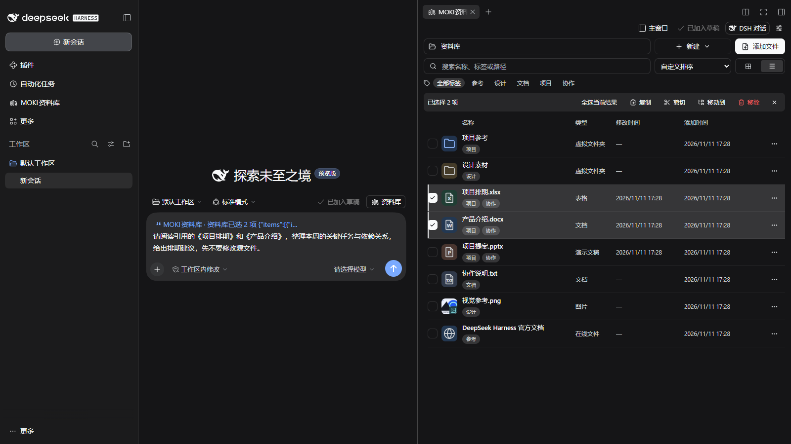
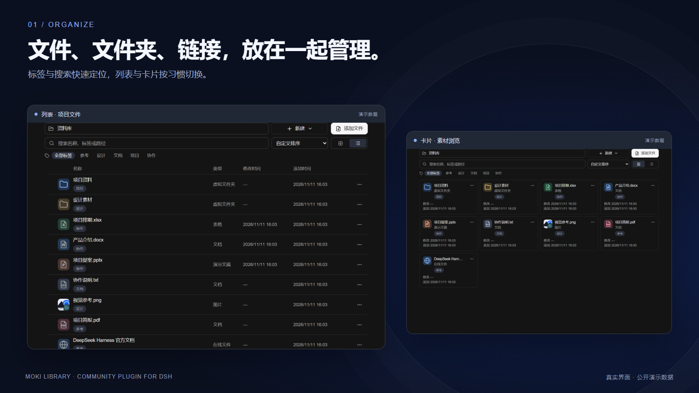
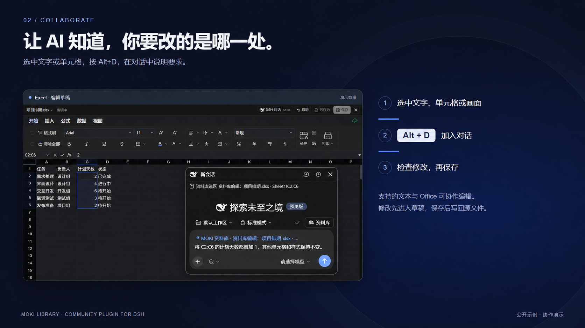
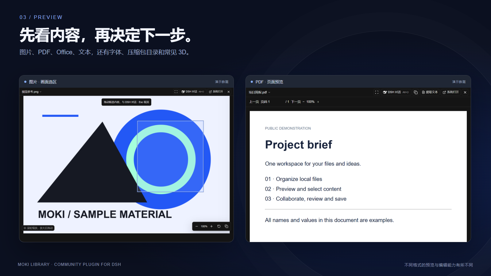

# 资料库 for DSH

[English](README.md) · 简体中文



**给DSH加个资源管理器 让AI生成井然有序**

MOKI 资料库是为 **DeepSeek Harness（DSH）** 开发的社区插件。管理本地文件、文件夹和链接，预览多种格式，选中内容后直接与 DSH 对话协作。

从「找文件」到「看内容、改选区、检查保存」，在一个工作流程里完成。既可以整理项目资料，也可以把文档、表格与当前对话并排打开。

[五组用法演示](docs/usage-demos.zh-CN.md) · [预览与编辑格式支持](docs/formats.zh-CN.md) · [图文素材](docs/social/README.md)

[下载安装包](https://github.com/JKZeng-cell/moki-library-for-dsh/releases/latest) · [完整使用说明](docs/guide.zh-CN.md) · [功能介绍](docs/features.md) · [反馈与建议](https://github.com/JKZeng-cell/moki-library-for-dsh/issues)

## 能做什么

- **文件统一管理**：映射本地文件和文件夹、创建虚拟目录、标签筛选、快速检索、卡片与列表视图。空目录支持拖拽添加提示。
- **多格式预览**：图片、音视频、PDF、Office、文本、压缩包目录、字体及常见 3D 格式。部分格式有解码和兼容性限制。
- **Office 协同编辑**：Word、Excel、PPT 在隔离草稿中编辑，实时查看修改结果，确认后保存或另存为。
- **选哪里，就协作哪里**：传递文本位置、工作表与单元格范围、幻灯片对象、PDF 页码或画面选区。按 **Alt+D** 唤起 DSH 对话。
- **适应不同工作方式**：主窗口管理、侧边工作区多标签、可跨屏移动的独立预览窗口，也可选择系统默认应用。对话浮窗可拖动、缩放，使用 DSH 原生输入能力。
- **连接对话和任务文件**：可选开启资料库附件选择入口；自动把 DSH 新建或交付的任务文件映射进资料库。
- **精简选区传递**：只传必要的选区正文与准确位置；支持的简单修改通过 `context → edit_selection` 完成，复杂修改按需调用 Office 工具。



**资料库和会话并排协作。** 本机 DSH Web 完整界面实拍：右侧选中「项目排期.xlsx」与「产品介绍.docx」，点击「选区加入对话」后，左侧原生输入框显示资料库引用，再输入任务要求。画面使用演示文件，输入草稿尚未发送。[查看卡片模式版本](docs/media/dsh-workspace-cards.png)。





## 安装

已验证环境：**Windows / DSH 桌面版 0.2.2-rc.1**。插件声明兼容 `>=0.2.2-rc.1 <0.3.0`，其他版本和操作系统仍需验证。要求 **Node.js 22.19+**。独立预览窗口需要本机安装 Edge 或 Chrome；FFmpeg 为可选的音视频解码依赖。

1. 先启动一次 DSH 桌面端完成配置初始化，再完全退出。在 [Release](https://github.com/JKZeng-cell/moki-library-for-dsh/releases/tag/v0.1.58) 下载 `dsh-moki-library-0.1.58.tgz`。
2. 使用 DSH 桌面端附带的 CLI，将下方路径改为安装包的实际绝对路径：

```powershell
dsh plugin --profile desktop add 'dsh-moki-library@file:C:/Downloads/dsh-moki-library-0.1.58.tgz' --allow-build=sharp
```

Windows 的 CLI 位于 DSH 安装目录中的 `resources/runtime/cli/bin/dsh.cmd`。首次安装需要下载依赖，若插件管理器提示重启，请按提示重新打开 DSH。

GitHub 的 Source code 压缩包用于开发；`.tgz` Release 资产是可安装插件。本次发布不依赖 npm 上架。

## 如何与 DSH 协作

### 第一次使用

1. 从 DSH 侧边栏打开「MOKI资料库」，用「添加文件」或拖拽添加文件、文件夹与链接；空目录会显示拖入提示。
2. 用虚拟目录和标签整理资料，通过搜索定位；路径栏可粘贴路径，搜索框支持一键清除。列表便于比较文件，卡片和悬浮缩略图便于浏览素材。
3. 打开文件。默认在主窗口资料库中使用独立预览窗口，在侧边工作区中使用新标签页；也可在设置中指定主窗口、独立窗口或默认应用。
4. 对支持编辑的文件点击「编辑」，选中要讨论或修改的位置。按 **Alt+D**，点击「选区加入对话」，再输入要求。
5. 在文件中检查修改结果，再「保存」或「另存为」。保存前的 AI 修改保留在草稿中；关闭重开文件可核对是否写入。

### 可以照着做的协作示例

| 场景 | 先选择什么 | 示例指令与检查方式 |
| --- | --- | --- |
| Excel 排期 | 工作表中的 `C2:C6` | 「只把所选计划天数都增加 1，其他单元格和样式保持不变。」检查数值后保存并重开 |
| Word / 文本改写 | 一段文字 | 「改得更简洁，保留事实和专有名词，只修改选中段落。」检查上下文与样式 |
| PPT 标题 | 当前页文本框中的标题文字 | 「改为『先检查，再保存』，保留文本框位置和字号。」检查换行与排版 |
| PDF 阅读 | 对应页的一段正文 | 「解释这段内容，注明页码，列出需要进一步核实的条件。」只读分析 |
| 图片 / 扫描页 | 框选画面区域 | 「描述框选区域，无法辨认的文字请明确标注。」需要当前模型支持视觉 |



查看[完整图文演示](docs/usage-demos.zh-CN.md)，包含逐步操作、示例输入、结果检查以及侧边工作区与独立窗口的用法。示例指令是操作参考，不是伪造的 AI 对话记录。

### 选区、附件和任务文件

「选区加入对话」传递当前所选内容和位置；「资料库 → 添加附件」提供选中的文件。后者需要在设置中开启「对话输入框显示资料库」。另一个可选设置「自动映射 DSH 任务文件」会将开启后 DSH 新建或交付的本地文件收纳到「DSH 任务文件」，相同路径只映射一次。

悬浮对话可移动、调整大小、新建会话和切换历史，使用 DSH 原生输入能力。使用独立窗口时，按 Alt+D 可在当前预览内继续协作。

选区上下文默认最多 4,000 字符，加入输入框的引用默认最多 1,000 字符，截断会明确标记，可按需读取更多。编辑引用绑定当前会话与编辑器，十分钟后过期；内容变化或重复使用会拒绝修改。

## 文件预览与编辑格式

| 类别 | 主要格式 | 预览 | 内嵌编辑 |
| --- | --- | --- | --- |
| Word / Excel / PPT | DOCX、XLSX、PPTX | 支持 | 支持，先改草稿再保存 |
| 分隔表格 / 工作区 | CSV、TSV、UNIVER | 支持 | 支持；CSV/TSV 不保留工作簿样式 |
| 文本与代码 | TXT、MD、JSON、HTML、XML、YAML、JS/TS、Python 等 | 支持 | 所列可编辑扩展名且不超过 5 MB |
| 旧版与 Apple Office | DOC、PPT、PAGES、NUMBERS、KEY | 内容提取，兼容性有限 | 不支持，先转换为可编辑格式 |
| 图片与设计稿 | PNG、JPEG、GIF、WebP、SVG、BMP、AVIF、ICO、PSD/PSB、TGA、TIFF | 图片或合并图像 | 不提供图像 / 图层编辑 |
| PDF / OFD / AI | PDF、OFD，含 PDF 兼容数据的 AI | 页面、文字或画面 | 读取分析，不提供原格式编辑 |
| 音视频 | MP4、MOV、MKV、AVI、WebM；MP3、WAV、FLAC、AAC、OGG 等 | 依赖编码，必要时使用 FFmpeg | 不提供剪辑编辑 |
| 3D / 字体 | GLB、glTF、OBJ、STL、PLY、FBX；TTF、OTF、WOFF、WOFF2 | 模型操作 / 字体试览 | 不修改模型或字体源文件 |
| 压缩包 | ZIP/ZIP64、RAR5、7z、TAR、GZ、BZ2、XZ、CAB 等 | 只读目录、搜索、分页 | 不编辑包内文件 |

HEIC/HEIF 取决于解码器；旧版 XLS、宏文档和受密码保护文件不列为已支持的内嵌编辑格式。详细扩展名、附属资源要求、只读格式、大小及兼容性限制见[完整支持表](docs/formats.zh-CN.md)。**可预览不等于可编辑，也不代表所有文件变体都能完全还原。**

## 数据与边界

目录索引、生成文件与草稿保存在本机 `DSH_HOME/moki-library` 或用户目录的 `.dsh/moki-library` 中。映射文件继续指向原路径。**加入对话的附件或选区会交给 DSH 及其配置的模型、工具处理**，本地存储不代表 AI 处理完全离线。

映射和流式原文件预览没有统一大小上限，但仍受解码器、内存和磁盘空间约束。对话附件单独限制为 **32 MB**；超过 **5 MB** 的文本使用只读分页；部分整体解码格式有 **512 MiB** 内存保护；Office 结构化预览的展开数据预算为 **256 MiB**。详见[格式与大小说明](docs/guide.zh-CN.md#文件预览与大小)。

## 开发

```sh
npm ci
npm run build
npm test
node scripts/collect-licenses.mjs
npm pack
```

浏览器与 Office 测试需要本机 Chrome 或 Edge，使用临时生成的示例文件，串行执行以避免 Office 运行时竞争。DSH 适配在 `src/`，嵌入界面在 `web/`，资料库所需的 MOKI 模块在 `vendor/moki/`。

## 开源与社区

MOKI 代码采用 [MIT](LICENSE) 许可，第三方依赖保留各自许可，见[第三方声明](THIRD_PARTY_NOTICES.md)。欢迎通过 [Issues](https://github.com/JKZeng-cell/moki-library-for-dsh/issues) 反馈问题和需求，也欢迎提交改进。

[参与贡献](CONTRIBUTING.md) · [公开版本净化说明](docs/public-release.md) · [图文素材包](docs/social/README.md) · [DSH 插件社区](https://github.com/topics/dsh-plugin)

已加入官方 **Show Your Plugins!** 分区：[MOKI 资料库社区讨论](https://github.com/deepseek-ai/deepseek-harness/discussions/12941)。

开发者：**JKZeng / MOKI**。本项目是独立社区插件，不是 DeepSeek 官方产品。图中的 DeepSeek Harness 标志用于标识宿主应用，其商标权属于相应权利人。
