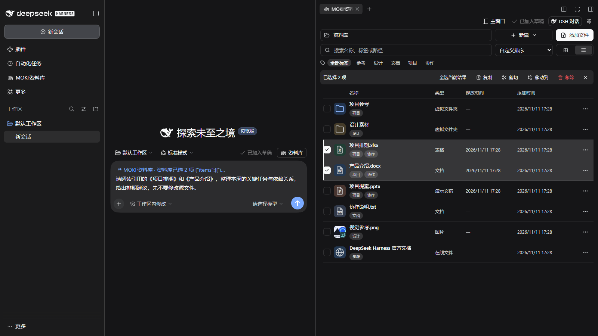

# 资料库 for DSH / Feature overview

MOKI 资料库把「找到文件 → 预览内容 → 选中位置 → 对话协作 → 检查保存」连接到同一个 DSH 工作流程中。

MOKI Library connects **find → preview → select → collaborate → review and save** inside DeepSeek Harness.

| 场景 / Use case | 功能 / Capability |
| --- | --- |
| 整理项目资料 / Organize a project | 本地文件与文件夹映射、虚拟目录、标签、搜索、卡片和列表 / Local mappings, virtual folders, tags, search, cards and lists |
| 快速看内容 / Inspect content | 图片、音视频、PDF、Office、文本、字体、压缩包目录和常见 3D / Images, media, PDF, Office, text, fonts, archives and common 3D |
| 精确协作 / Collaborate precisely | 传递选中文字和位置、单元格范围、幻灯片对象与画面区域 / Text and offsets, cell ranges, slide objects and visual regions |
| 修改 Office / Edit Office documents | Word、Excel、PPT 隔离草稿，实时显示，保存或另存 / Isolated drafts, live updates, save or save a copy |
| 边看边问 / Discuss while viewing | Alt+D 唤起原生 DSH 对话，浮窗可移动和缩放 / Alt+D opens native DSH chat in a movable, resizable panel |
| 多文件并行 / Work across files | 侧边工作区多标签、独立预览窗口、跨屏查看 / Side-workspace tabs and separate preview windows |
| 接入对话 / Attach library items | 可选开启附件选择器和任务文件自动映射 / Optional attachment picker and automatic task-file mapping |

## 完整工作区 / Full workspace

在右侧资料库勾选「项目排期.xlsx」和「产品介绍.docx」，点击「选区加入对话」，再在左侧输入要求。图中可同时看到 DSH 导航、资料库文件列表、已选状态和原生输入框中的引用。使用本机 DSH Web 与新建演示资料实拍，输入内容尚未发送。[卡片模式版本](media/dsh-workspace-cards.png)。

Select the two demo files in the right-hand library, choose **Add selection to conversation**, then describe the task on the left. The capture includes DSH navigation, the library, selected files and the native composer reference. Captured from local DSH Web with purpose-made files and an unsent draft. [Card-view alternative](media/dsh-workspace-cards.png).

## 从整理到保存 / From organization to saving

先将本地文件、文件夹和参考链接加入资料库，用虚拟目录与标签组织项目，再通过搜索定位。列表适合查看名称、类型与时间，卡片和缩略图气泡适合浏览视觉素材。路径栏可粘贴路径，空目录支持拖拽添加，Windows 还可将选中文件拖到其他应用或复制后粘贴。

Map local files, folders and reference links, organize them with virtual folders/tags, then search by name, tag or path. Lists expose file details; cards and hover previews help browse visual assets. Windows supports dragging selected files into other apps or copying/pasting them.

打开可编辑文件后，选择明确的段落、单元格或文本框位置，按 **Alt+D** 将选区加入当前对话。DSH 能读取所选内容和位置，修改进入草稿，结果在编辑器中显示。检查后保存，或另存一份。

Open an editable file, select a passage, range or text-box position, and use **Alt+D** to add that selection to the current conversation. DSH can read the content and location, update the draft, and show the result in the editor for review before saving.

| 用法演示 / Demo | 示例要求 / Example request | 要检查什么 / What to check |
| --- | --- | --- |
| Excel 排期 / Schedule | C2:C6 的天数都增加 1 / Increase each planned-day value in C2:C6 by 1 | 数值、相邻单元格、保存回读 / Values, adjacent cells, reopen after save |
| Word / 文本 / Text | 缩短选中段落，保留事实 / Shorten the selected passage without changing facts | 原意、上下文、样式 / Meaning, context and formatting |
| PPT 标题 / Slide heading | 只改所选文本框的标题 / Change only the selected text-box heading | 对象位置、字号、换行 / Position, font size and wrapping |
| PDF 阅读 / Reading | 解释选中段落，注明页码 / Explain the selected passage and identify its page | 引用范围和依据 / Selection scope and supporting content |
| 图片分析 / Image analysis | 描述框选区域 / Describe the selected image region | 图像范围与模型是否看清 / Captured area and visual uncertainty |

[中文：完整图文演示](usage-demos.zh-CN.md) · [English: illustrated steps](usage-demos.md)

## 预览与编辑支持 / Preview versus editing

| 范围 / Group | 格式示例 / Formats | 能力 / Capability |
| --- | --- | --- |
| Office / 表格 | DOCX, XLSX, PPTX, CSV, TSV, UNIVER | 预览、编辑草稿、保存 / Preview, draft editing and saving |
| 文本与代码 / Text and code | TXT, MD, JSON, HTML, XML, YAML, JS/TS, Python 等 / and more | 所列扩展名支持编辑，超过 5 MB 只读分页 / Listed editable extensions; read-only paging above 5 MB |
| 图片与设计稿 / Images and design | PNG, JPEG, WebP, GIF, SVG, PSD/PSB, TIFF, TGA 等 / and more | 图片或合并图像预览、画面选区分析 / Image/composite previews and region analysis |
| 文档阅读 / Documents | PDF, OFD, PDF-compatible AI | 页面、文字与画面选区；非原格式编辑 / Page, text and region selection; no source-format editor |
| 音视频 / Media | MP4, MOV, WebM, MKV, MP3, WAV, FLAC 等 / and more | 依赖编码播放，可用本机 FFmpeg / Codec-dependent playback, optional local FFmpeg |
| 模型与字体 / Models and fonts | GLB, glTF, OBJ, STL, PLY, FBX; TTF, OTF, WOFF/WOFF2 | 模型查看、字体试览 / Model viewing and font samples |
| 压缩包 / Archives | ZIP/ZIP64, RAR5, 7z, TAR, GZ 等 / and more | 只读目录、搜索、分页 / Read-only directory, search and paging |

旧版 DOC/PPT 与 Apple Office 仅有内容提取预览；HEIC/HEIF 依赖解码器；XLS、宏文档、加密文件等需使用默认应用。CSV/TSV 不保存工作簿格式，图片预览不提供图层编辑，字体试览也不修改字体文件。

Legacy DOC/PPT and Apple Office have limited content extraction. HEIC/HEIF require decoder support; XLS, macro-enabled and encrypted documents should use the default app. CSV/TSV do not retain workbook formatting; image previews do not edit layers, and font samples do not modify font files.

[中文：完整格式表与容量限制](formats.zh-CN.md) · [English: full format matrix and limits](formats.md)

## 窗口与输入 / Windows and input

侧边工作区默认以新标签页打开文件，主窗口资料库默认使用可跨屏移动的独立预览窗口；设置可指定主窗口、独立窗口或默认应用。Alt+D 对话浮窗留在当前预览中，可拖动、调整大小、新建或切换历史会话。附件选择入口与任务文件自动映射分别开启，适合「整份文件参与对话」和「将 DSH 产出集中管理」两种需要。

Side-workspace files open in tabs by default; the main library uses separate preview windows that can move across screens. Settings select the destination. Alt+D chat stays in the preview and supports moving, resizing and new/history conversations. Enable the attachment picker and task-file mapping separately for whole-file inputs and managing new DSH outputs.

## 产品边界 / Product boundaries

预览格式的能力不同，读取不代表所有格式都可原位编辑。图片、PDF 等可把文字或画面选区交给 AI 理解；Word、Excel、PPT 和支持的文本可进入编辑流程。先查看草稿结果，再保存到源文件。

Preview and editing support differ by format. Image/PDF regions can be provided for AI understanding; supported text and Office documents can be edited. Review the draft before writing back to the source file.

文件保存在本地，但加入 AI 对话的内容会交给 DSH 配置的模型和工具。Windows 已验证；其他平台、特殊格式与大型文件请以实际环境和使用说明为准。

Files are stored locally, while content supplied to AI is processed through DSH's configured model/tools. Windows is verified; other platforms and unusual or large files require validation in the target environment.
