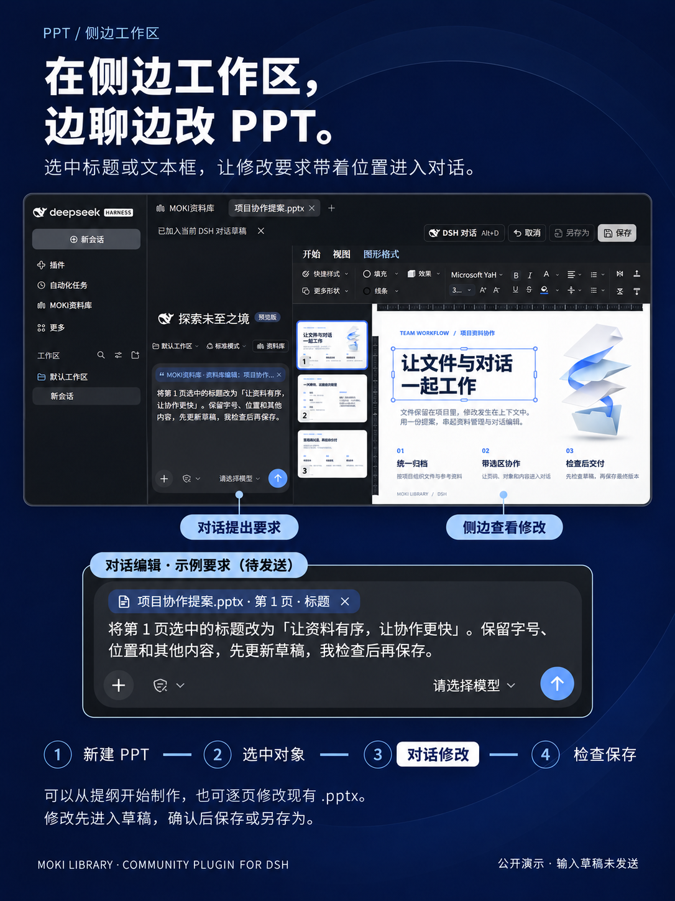
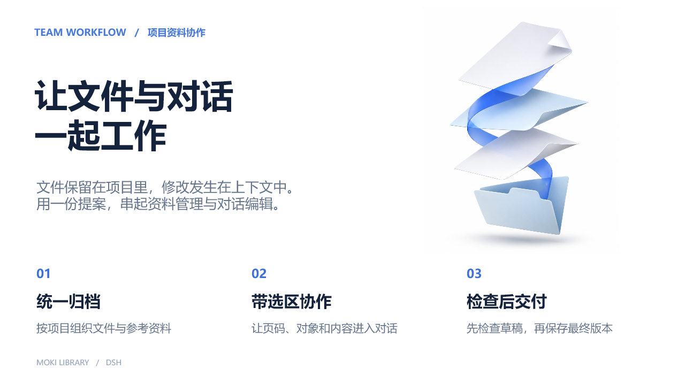
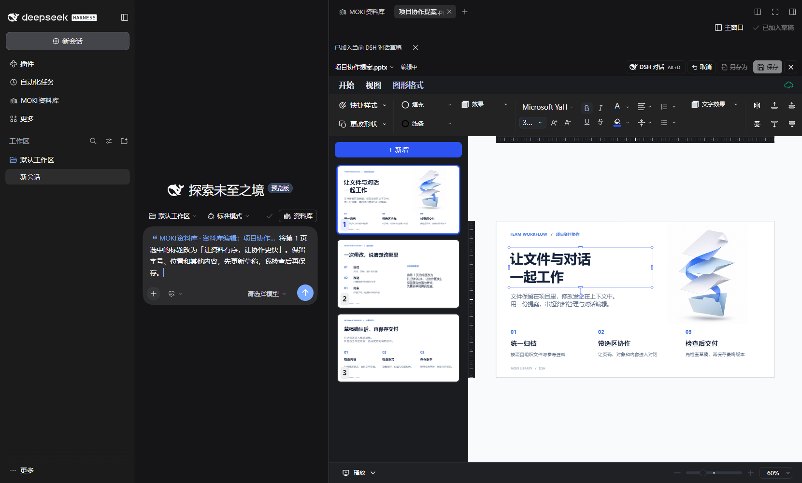

# Create and edit presentations in the side workspace

[简体中文](ppt-side-workspace.zh-CN.md) · [Usage demos](usage-demos.md) · [Install](../README.md#install-with-dsh)

Keep DSH chat beside your presentation: give instructions on the left and inspect the slide on the right. The library and each file retain their own tabs.

## Try the three-slide example

[Download the editable project collaboration demo](examples/project-collaboration-demo.pptx), then add it to the library to preview or edit it.

The deck covers file organization, precise editing instructions, and review before delivery. It uses white pages, navy headings and blue accents. Its cover includes a file-themed illustration; headings and body copy remain editable text for practicing selection collaboration.

## Start a new presentation

1. Open MOKI Library and move it to the **side workspace**.
2. Use **New** to create a `.pptx`, or add an existing presentation. The default side-workspace behavior opens files in new tabs; restore the default preview preference if you changed it.
3. Enter edit mode and explain the topic, audience, page count and structure. For example: “Create three slides about project file collaboration: organizing files, editing selections, and reviewing before delivery. Use white pages, navy headings, blue accents, clear typography and generous spacing. Update the draft for review; do not save the source yet.”
4. Review the content, line breaks and layout on the right, then refine the instructions. Output quality depends on the model and request; complex layouts require review.

## Refine a selected title through conversation

1. Select a title shape on the target slide. To change just one passage, enter text editing and highlight that passage instead.
2. Choose **Add selection to conversation**. The reference includes the file, slide number, object ID and selected content. The example selects the title on slide 1 of `项目协作提案.pptx`.
3. Ask, for example: “Replace the title selected on slide 1 with ‘Organized files, faster collaboration.’ Keep its font size, position and all other content. Update the draft for me to review before saving.”
4. Select a configured model and send. Review the updated draft in the adjacent editor. **Alt+D** can also open DSH chat with the current selection.
5. Save after review, or use **Save As** to retain the original. Close and reopen the file to confirm the saved result.

The promotional illustration uses purpose-made, local DSH Web demonstration captures. Its composer contains an **unsent draft**, not a fabricated assistant response. The sample deck was prepared in advance and imported into DSH; its decorative illustration is AI-generated. The captures show the actual file, title selection and reference input, not a claimed one-shot generation result.

## Colors and format support

- `.pptx` supports preview and collaborative editing. Convert legacy `.ppt` to `.pptx` before editing in the embedded editor.
- From **0.1.59**, dark editor chrome preserves original slide text, backgrounds and gradients. Slides without an authored background use white paper; existing dark designs retain their original colors.
- Save drafts and fully restart DSH after upgrading. Already-open windows do not automatically replace their editor code.
- Review selected text, shape placement and formatting before saving. See the [format matrix](formats.md) for compatibility details.
