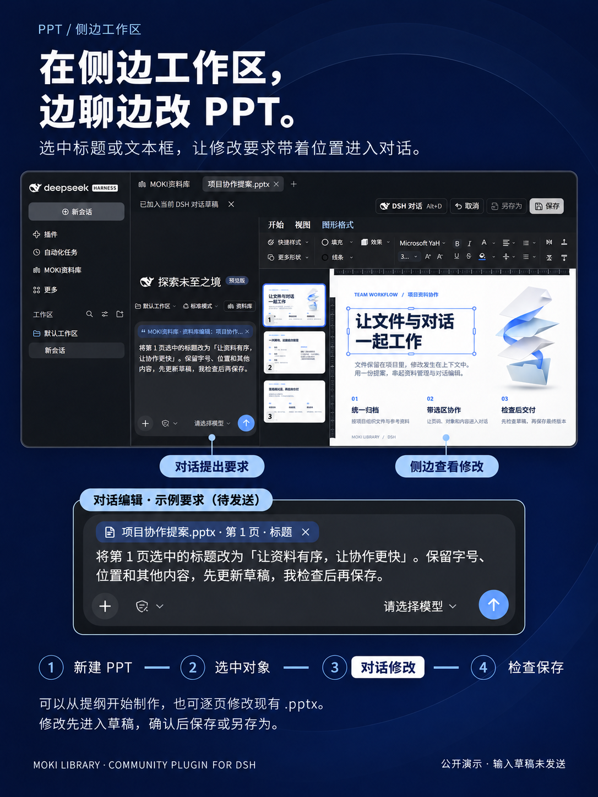
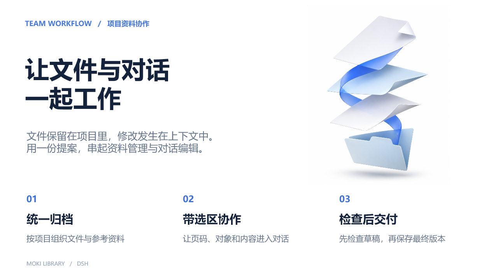
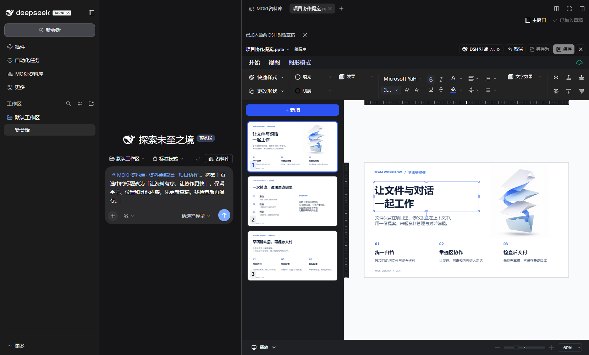

# 在侧边工作区制作、编辑 PPT

[English](ppt-side-workspace.md) · [图文演示](usage-demos.zh-CN.md) · [安装](../README.zh-CN.md#install-with-dsh)

让 DSH 对话与 PPT 编辑器并排显示：在左侧提出要求，在右侧检查幻灯片。资料库和文件各自保留标签页，可来回切换。

## 可直接体验的三页示例

[下载「项目协作提案.pptx」](examples/project-collaboration-demo.pptx)，添加到资料库后即可预览或编辑。

示例包含「文件与对话协作」「精确描述修改要求」「检查与交付」三页，统一使用白色页面、深蓝标题和蓝色强调色。封面配有文件主题插画，标题与正文保留为可编辑文本，方便直接练习选区协作。

## 从一份新演示稿开始

1. 打开「MOKI资料库」，点击顶部「侧边工作区」。
2. 用「新建」创建 `.pptx`，或把已有演示稿添加到资料库。侧边工作区默认在新标签页打开文件；若改过预览偏好，可先恢复默认打开方式。
3. 进入编辑模式。向 DSH 说明主题、受众、页数和结构，例如：

   > 在当前 PPT 草稿中制作三页项目资料协作提案，依次介绍资料归档、选区修改、检查交付。使用白色页面、深蓝标题和蓝色强调色，标题与正文层级清楚，保留充分留白。先更新草稿，让我检查，不要直接保存源文件。

4. 在右侧逐页检查内容、换行和布局，再继续提出调整要求。生成质量取决于模型与任务描述，复杂排版需人工检查。

## 选中标题，通过对话精修

1. 切到目标幻灯片，单击选中标题框。需要只改其中一句时，双击进入文本编辑，再选中那句话。
2. 点击「选区加入对话」。引用会带上文件、页码、对象 ID，以及所选文字；示例为 `项目协作提案.pptx · 第 1 页 · 标题`，原标题是「让文件与对话一起工作」。
3. 在 DSH 原生输入框中说明要求，例如：

   > 将第 1 页选中的标题改为「让资料有序，让协作更快」。保留字号、位置和其他内容，先更新草稿，我检查后再保存。

4. 选择已配置的模型并发送。修改先进入编辑草稿，完成后在右侧检查文字与排版。按 **Alt+D** 也可唤起带当前选区的 DSH 对话。
5. 检查高亮的修改后点击「采纳」，再「保存」或「另存为」。不满意可取消本次修改；继续让 DSH 修改时会追加待确认记录。关闭后重新打开，核对写回结果。

演示图由本机 DSH Web 的公开示例截图编排，输入草稿未发送，没有虚构 AI 回复。示例 PPT 预先制作后导入 DSH，插画使用 AI 生成素材；截图展示的是实际文件、标题选区及引用输入，不代表一次自动生成的结果。

## 配色与格式

- `.pptx` 支持预览和协作编辑；旧 `.ppt` 需先转换为 `.pptx` 才能进入内嵌编辑。
- 从 **0.1.59** 起，深色编辑界面保留幻灯片原本的文字、背景和渐变颜色。未设置背景的页面默认白底；已有深色设计不会被强制改成白底。
- 升级插件后先保存草稿，再完全退出并重新打开 DSH。已打开窗口不会自动替换编辑器代码。
- 选区、文本框位置和样式仍应在保存前检查。更多兼容范围见[格式支持表](formats.zh-CN.md)。
