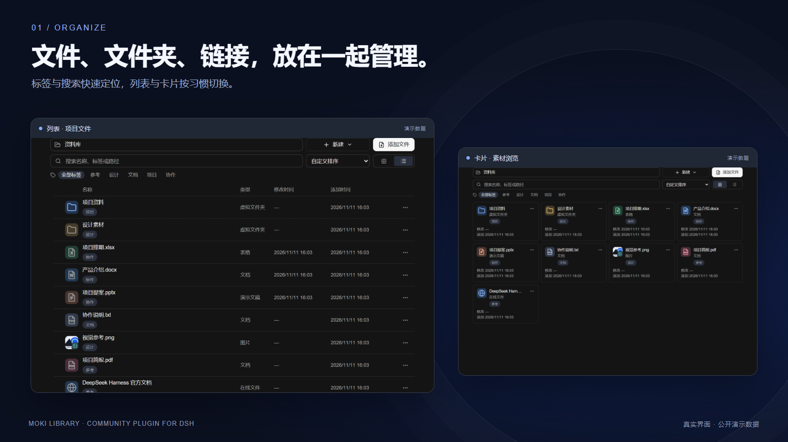
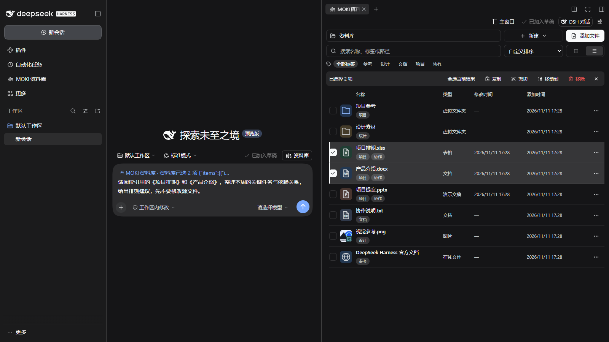
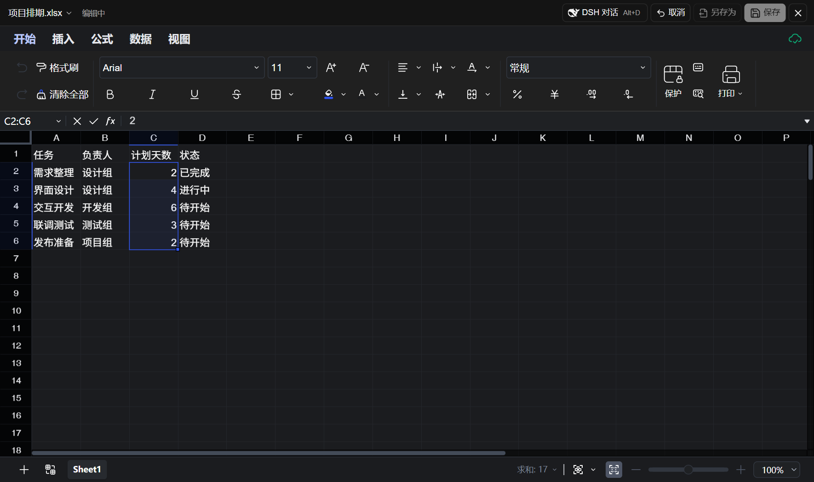
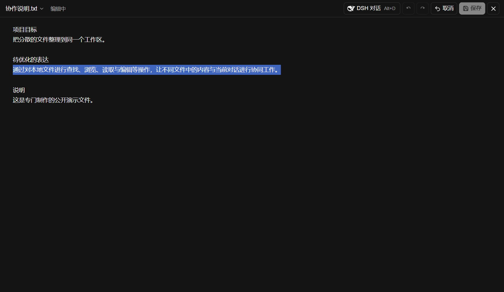
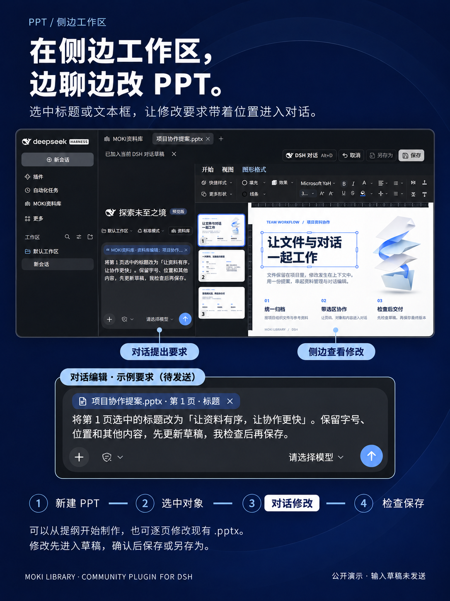
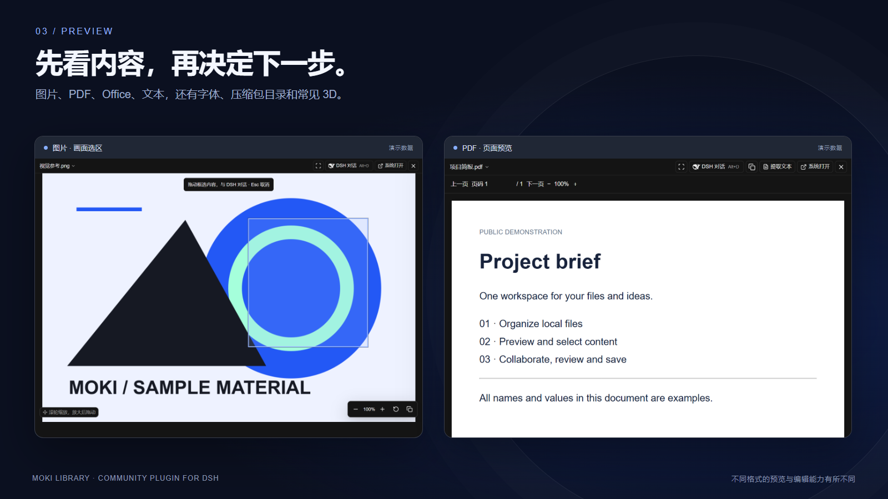

# Library for DSH: five usage demos

[简体中文](usage-demos.zh-CN.md) · [Features](features.md) · [Format support](formats.md) · [Installation](../README.md#install)

These are step-by-step examples you can follow. Screenshots contain purpose-made demonstration files; the suggested prompts are instructions, not fabricated AI conversation transcripts. Start with copies of your files.

## 1. Organize project files and attach them to a conversation

1. Open **MOKI Library** in DSH's sidebar. Use **New** to create a virtual folder, such as “Project references”.
2. Drag files, folders or links into the content area, or use **Add files** to map them. Apply tags such as “Project”, “Design” or “Reference”.
3. Search by name, tag or path. Clear the search to restore the list. Use cards for browsing assets and the list for comparing types and dates.
4. Enable the **library button above the conversation input** in settings. In the DSH composer, open **Library**, select files and choose **Add attachments**. Describe your task and send the message.

**Example prompt:** “Read the attached project brief and schedule. Identify three dependencies we should confirm early, and identify the source file for each finding.”

Mapping normally preserves the file's existing location. Dropping into a mapped local folder copies files into that disk directory. Attaching a complete file is separate from supplying a selected passage; each attachment is limited to 32 MB.

### Reference selected library items beside the conversation

1. Choose **Side workspace** from the library toolbar to keep the library beside the conversation.
2. Select the checkboxes for the files to discuss. This example uses “项目排期.xlsx” and “产品介绍.docx”.
3. Click **Add selection to conversation**. The toolbar changes to **Added to draft**, and a native reference appears in the DSH composer.
4. Enter a request, for example: “Read the referenced schedule and product introduction, identify this week's key tasks and dependencies, and suggest scheduling improvements. Do not modify the source files yet.” Check the reference and choose your configured model before sending.

This is an actual local DSH Web capture with demonstration files and an unsent draft. A library-item reference lets DSH tools locate the selected items; it is distinct from uploading complete files with **Add attachments**. The same selection is also shown in [card view](media/dsh-workspace-cards.png).

## 2. Excel: change only C2:C6

1. Open the sample schedule `.xlsx` and choose **Edit** to enter its draft.
2. Select the intended sheet and range `C2:C6`. In the screenshot, the planned-day values are `2, 4, 6, 3, 2`.
3. Press **Alt+D** and choose **Add selection to conversation** above the input.
4. Ask: “Read the current sheet and C2:C6, then increase each selected planned-day value by 1. Keep all other cells and styles unchanged.”
5. After the tool completes, inspect `3, 5, 7, 4, 3` in those cells, and confirm that adjacent tasks, owners and statuses are unchanged.
6. Choose **Save**, close and reopen the file to check persistence. Use **Save as** to retain the original.

Edits appear in the draft. A chat message claiming success does not replace checking the grid and save state. Formulas, large ranges or non-contiguous selections may need more extensive Office operations.

For a read-only task, ask: “Explain the selected formula and its references. Do not change the file yet.”

## 3. Word / text: revise one passage in context

1. Open `.docx` in the Office editor, or choose **Edit** for a supported text file. The screenshot above shows the plain-text editor, not Word.
2. Select the sentence or paragraph, press **Alt+D** and add the selection to the conversation.
3. Ask: “Make this passage more concise while preserving facts and proper names. Change only the selected range and keep other paragraphs intact.”
4. Review the new wording and formatting. Save, continue refining, or undo the edit.

The context carries the file, exact location and selected content. Repeated wording elsewhere in the file does not have to be changed. If the reference expires or the original content changes, select it again.

Legacy `.doc` is preview-only; convert it to `.docx` first. Text files above 5 MB use read-only paging.

## 4. PowerPoint: edit a specific text box

[Full guide: create and edit PPTs in the side workspace](ppt-side-workspace.md). Start a new presentation or refine selected objects and text in an existing deck. Give instructions in the conversation and review the draft beside it.

1. Open `.pptx`, enter the editor and select the intended slide.
2. Selecting an object provides its object context. Entering its text box and highlighting characters provides an exact text selection.
3. Press **Alt+D**, add the selection and ask: “Replace the selected heading with ‘Review before saving’. Preserve the text-box position, font size and all other slides.”
4. Check the wording, layout and wrapping. Save and reopen the file.

Specify whether you want to replace the entire object's text or only the highlighted passage. Cross-paragraph or mixed-style edits need additional care. Legacy `.ppt` is preview-only and must first be converted to `.pptx`.

## 5. PDF / images: ask about a page or selected region

**PDF text:** open the page → select text → Alt+D → add selection → ask “Explain this clause, identify its page and list conditions I should verify.”

**Scanned PDF / image:** choose **Select a region to collaborate with DSH** → drag over the area → Alt+D → add selection → ask “Describe the selected area. Explicitly mark any text you cannot read.”

The context can include the page or captured region and its position. Image understanding requires a vision-capable model; scanned text can also use separately configured OCR. Reading or analyzing a region does not enable in-place editing of a PDF, PSD or image file.

## Choose your workspace

| Workflow | How | Useful for |
| --- | --- | --- |
| Side workspace | Move the library to the side workspace; files open in new tabs by default | Chat beside a document, compare several files |
| Separate preview window | Default from the main library, or select it in settings | Move the document to a second screen; Alt+D stays inside the current preview window |
| DSH main window / default application | Select the preview destination in settings | Focus on one file, or handle complex formats in their original applications |
| Floating conversation | Drag the header; resize edges or corners | Keep the selected content visible; create or switch historical conversations |

Two optional settings connect files with chat: **the library attachment picker** and **automatic task-file mapping**. The latter maps newly created/delivered DSH files after it is enabled, deduplicates identical paths and keeps existing mappings when disabled. It is not a full-disk scan or historical-file import.

Useful interactions: **Alt+D** opens chat; hold **Ctrl** during marquee selection to add items; Windows supports **Ctrl+C → Ctrl+V in the destination app** for selected files. Focus and the receiving application affect shortcut behavior.

Files and drafts are stored locally. Content supplied to AI is processed by DSH's configured model/tools. See the [format matrix](formats.md) for the detailed support boundaries.
