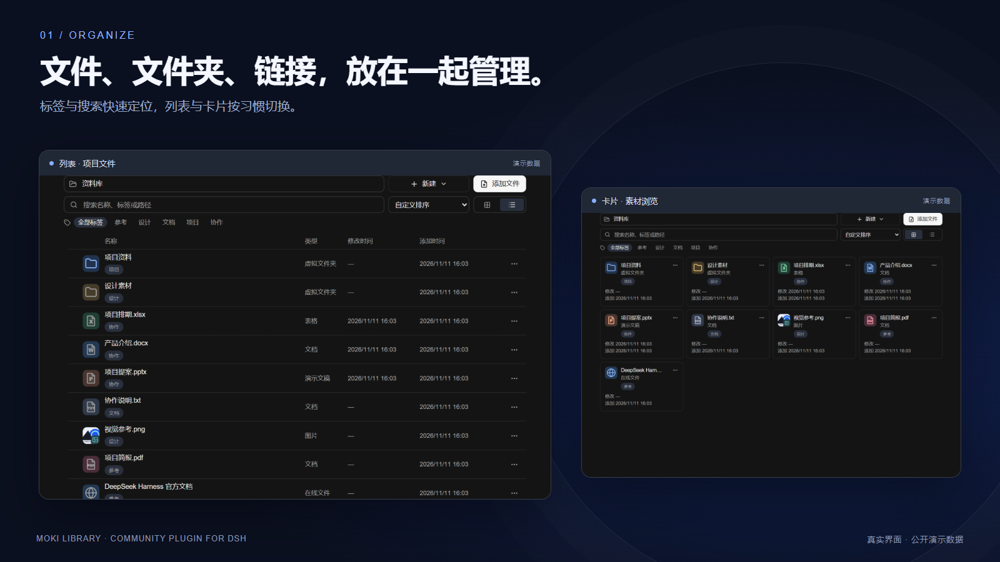
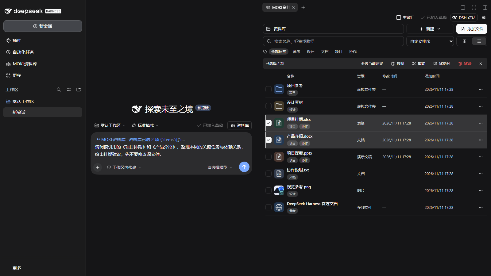
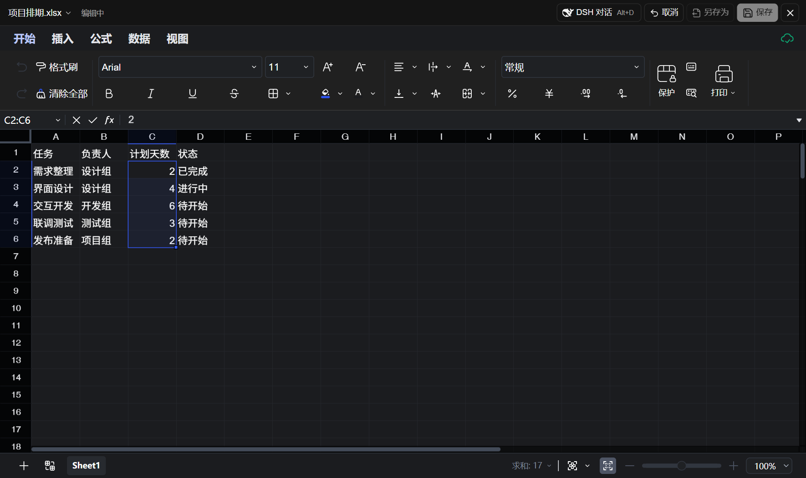
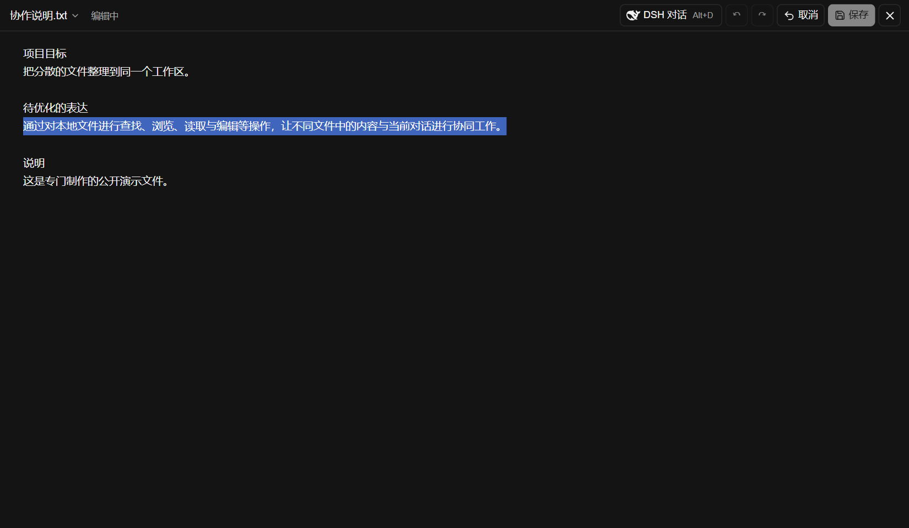
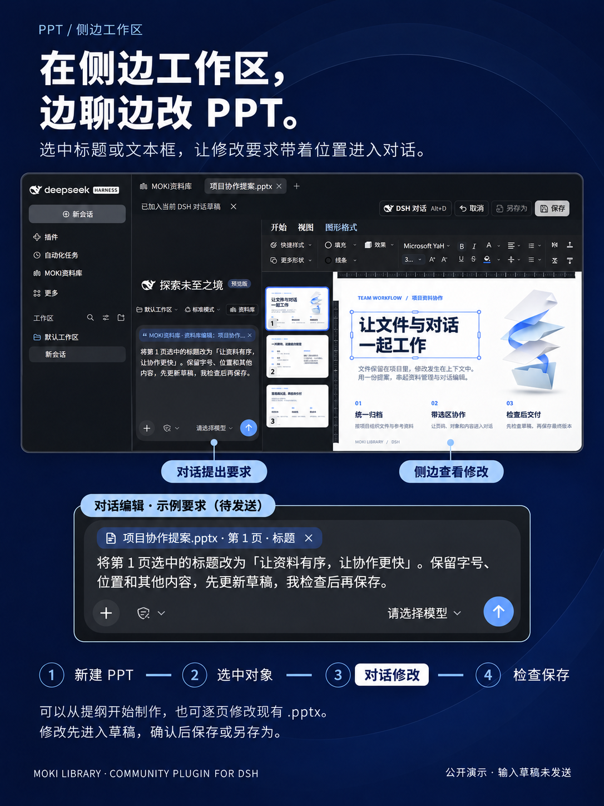
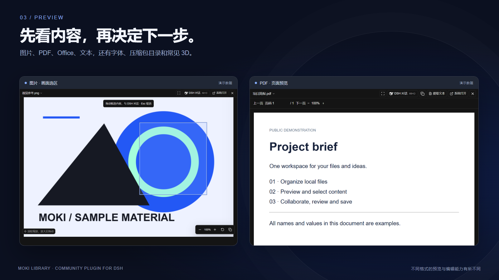

# 资料库 for DSH：五组用法演示

[English](usage-demos.md) · [功能介绍](features.md) · [格式支持表](formats.zh-CN.md) · [安装说明](../README.zh-CN.md#安装)

下面是可照着操作的图文示例。配图中的项目、数值和文件均为新建演示资料；示例指令不是伪造的 AI 对话记录。请先使用自己的文件副本练习。

## 1. 整理项目文件，再把资料送进对话

1. 在 DSH 侧边栏打开「MOKI资料库」，用「新建」创建虚拟目录，例如「项目参考」。
2. 将文件、文件夹或链接拖到内容区，或用「添加文件」添加映射；给资料加上「项目」「设计」「参考」等标签。
3. 用搜索框按名称、标签或路径定位，点清除按钮恢复完整列表；用卡片查看素材，用列表比较类型与时间。
4. 在设置中开启「对话输入框显示资料库」。回到 DSH 对话，点「资料库」，搜索并多选文件，再点「添加附件」。文件进入输入草稿后，输入任务要求并发送。

**示例指令：**「阅读我附上的项目说明和排期表，列出三个需要提前确认的依赖项，并注明依据来自哪个文件。」

**操作区别：**映射通常保留原文件位置，不自动复制全部文件。把文件拖进已映射的本地文件夹时会复制到该磁盘目录。附件是把文件交给当前对话，单个文件上限 32 MB；如果只讨论局部内容，可使用下面的选区协作。

### 并排打开资料库，把选中文件作为会话引用

1. 在资料库顶部点击「侧边工作区」，让资料库与 DSH 对话并排显示。
2. 勾选需要讨论的文件。图中选择了「项目排期.xlsx」和「产品介绍.docx」。
3. 点击「选区加入对话」。按钮变为「已加入草稿」，DSH 原生输入框中出现资料库引用。
4. 输入要求，例如：「请阅读引用的《项目排期》和《产品介绍》，整理本周的关键任务与依赖关系，给出排期建议，先不要修改源文件。」核对引用并选择已配置的模型后，再发送。

图为本机 DSH Web 完整界面实拍，使用新建演示资料，输入草稿尚未发送。这里加入的是供 DSH 工具定位所选条目的资料库引用，与「添加附件」上传完整文件有所区别。[查看同一选区的卡片模式](media/dsh-workspace-cards.png)。

## 2. Excel：只修改选中的 C2:C6

1. 打开 `项目排期.xlsx`，点击「编辑」进入草稿。
2. 切到需要的工作表，拖选 `C2:C6`。图中这一列是「计划天数」，数值为 `2、4、6、3、2`。
3. 按 **Alt+D** 唤起 DSH 对话，在输入框上方点「选区加入对话」。
4. 输入：「先读取当前工作表和 C2:C6，只将所选计划天数都增加 1，保留其他单元格和样式。」
5. 等待工具完成后，在表格中检查这五个值是否变为 `3、5、7、4、3`，同时确认相邻的任务、负责人和状态未变。
6. 检查高亮的改动，点击「采纳」，再「保存」。关闭并重新打开核对结果；需要保留原版时选择「另存为」。

修改先进入编辑草稿，界面可实时显示结果；**AI 回复“改好了”不能代替你检查表格和保存状态**。公式、较大范围或不连续选区可继续协作，但可能需要更完整的 Office 操作。

也可以只读不改：「解释所选公式引用了哪些单元格，先不要修改文件。」

## 3. Word / 文本：保留上下文，只改一段

1. 打开 `.docx` 并进入 Office 编辑器，或打开受支持的文本文件并点击「编辑」。上图展示的是纯文本编辑器，不是 Word 界面。
2. 在文档中选中需要改写的句子或段落，按 **Alt+D**，将选区加入对话。
3. 输入：「把选中段落改得更简洁，保持事实和专有名词，只修改选中范围，保留其他段落。」
4. 检查高亮的新文本、段落和样式；满意后「采纳」再保存，不满意可「取消本次修改」或继续提出修改要求。多次未确认修改可采纳全部，或逐次取消最新一次。

**为什么不用重新粘贴全文？**选区会携带当前文件、准确位置和所选内容。相同句子出现多次时，DSH 可以定位这一次选择；引用过期或原文改变后，需要重新选择以避免改错。

旧版 `.doc` 是内容预览，先在原应用另存为 `.docx` 才能使用内嵌编辑。大于 5 MB 的文本使用只读分页。

## 4. PPT：修改指定幻灯片的文本框

[完整介绍：在侧边工作区制作、编辑 PPT](ppt-side-workspace.zh-CN.md)。支持从新建演示稿开始，也可在现有 PPT 中选中对象或文字进行精修。左侧对话提出要求，右侧检查编辑草稿。

1. 打开 `.pptx`，进入编辑器并切到要修改的幻灯片。
2. **只选对象**时，对话会获得所选对象的信息；**进入文本框并选中文字**时，才能明确要改的是文本框中的哪一段。
3. 按 **Alt+D**，加入选区，输入：「将选中的标题改为『先检查，再保存』，保持文本框的位置、字号和其他页面内容。」
4. 在当前页面检查高亮的文字对象、布局和换行，点击「采纳」再保存，重新打开确认。

如果要改整个对象，可明确说「修改当前选中的文本框全部文字」；如果只改一句，就先进入该文本框选中那一句。跨段落或多种富文本样式的修改需要更细致的处理，检查完成后再保存。旧版 `.ppt` 仅预览，需先转换为 `.pptx`。

## 5. PDF / 图片：带着页码和画面区域提问

**PDF 文字：**打开文件 → 切到对应页 → 选中文字 → Alt+D → 加入选区 → 输入「解释这段条款，注明页码，列出需要我进一步核实的条件」。

**扫描 PDF / 图片：**点「框选区域与 DSH 协作」→ 框住需要查看的区域 → Alt+D → 加入选区 → 输入「描述框选部分的内容，若文字看不清，请明确标注无法辨认的地方」。

可传递页面或区域截图及其位置；图片理解需要当前 DSH 模型具备视觉能力。扫描文档的文字识别也可使用另行配置的 OCR。**这一步是读取和分析，不会将 PDF、PSD 或图片变成可直接修改的原格式文件。**

## 把协作放在合适的位置

| 工作方式 | 操作 | 适合的场景 |
| --- | --- | --- |
| 侧边工作区 | 从资料库切到「侧边工作区」，默认在新标签页中打开文件 | 左侧对话、右侧检查文件，多文件来回比较 |
| 独立预览窗口 | 主窗口中的默认打开方式，或在设置中指定 | 将文件拖到第二块屏幕，Alt+D 在当前预览窗口内对话 |
| DSH 主窗口 / 默认应用 | 在「资料库设置」中选择文件预览打开方式 | 专注单个文件，或交给文件原生应用处理复杂格式 |
| 悬浮对话 | 拖动标题栏移动，拖动边缘或四角调整大小 | 不挡住正在看的正文或单元格；也可新建、切换历史会话 |

## 两个可选的连接设置

- **对话输入框显示资料库：**提供文件附件选择入口，适合整份资料参与对话。
- **自动映射 DSH 任务文件：**将开启后 DSH 新建或交付的本地任务文件放进「DSH 任务文件」。相同路径只映射一次，关闭后保留已有映射；不是扫描全盘或导入所有历史文件。

常用操作：**Alt+D** 打开协作对话；**Ctrl** 配合框选追加选择；Windows 中 **Ctrl+C → 目标应用 Ctrl+V** 可传递已选文件。快捷键受当前焦点和目标应用接收能力影响。

文件和草稿保存在本机，加入 AI 对话的内容会交给 DSH 配置的模型与工具处理。更多范围与限制见[格式支持表](formats.zh-CN.md)。
